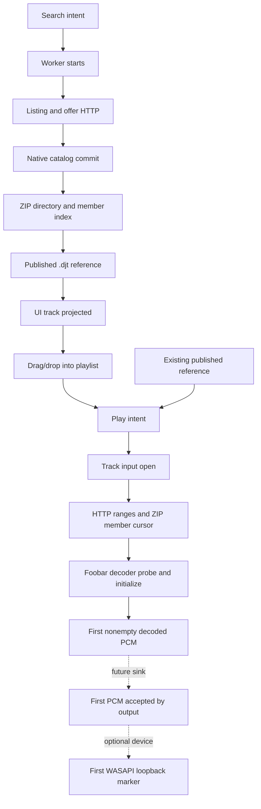

# End-to-end latency and time-to-first-audio evidence model

**Status: design/measurement contract, not measured Windows-host E2E.**
Source candidates: quality/cache-scenarios.json, quality/decoder-io-profiles.json,
quality/media-support.json. Native opt-in ETW builds are available as of v0.0.200
(#41); these test-only binaries have been compiled and packaged but have **not
been proven in a real interactive foobar2000 host**.

## The critical distinction: more than one clock and more than one user action

There is no single additive "search to first audio" critical path. Indexing
and idle enrichment can progress concurrently, selection is passive today,
and playback may begin from an existing published .djt reference without
repeating search or indexing. Record actual causal edges and concurrent work;
**never sum overlapping spans as if sequential**, and never match a background
worker event to a highlighted row merely because the timestamps are close.

## 1. Milestones and ownership

| Stage and boundary | Instrument / evidence | Current claim |
| --- | --- | --- |
| Search intent -> child coordinator starts | Robot/UIA plus component worker-start ETW | Worker-start source hook exists; no real GUI qualification |
| Listing request -> HTTP first byte -> complete response | WinHTTP or fake-host ledger, response status, IDs, RTT, transfer | Loopback ledger exists; native connection/range attribution incomplete |
| Search page / offer -> SQLite committed rows | Native worker IPC, second-connection DB oracle | Portable contracts, host sequence not verified |
| Archive ZIP tail -> central directory -> member offsets | ZIP metadata and cursor, archive identity + validators | Portable ZIP/fixture tests; stage-specific native ETW incomplete |
| Committed indexing -> published .djt -> UI projection | SQLite observer, file SHA, UI track-projected ETW | Publication contract; no real host UI verification |
| Select/focus | Robot select intent and UI selection ETW | Passive; selecting alone should not initiate new indexing or network |
| Drag/drop -> playlist entry | Drag hooks plus independent playlist/UIA assertion | Drag hook exists; result marker alone is not playlist proof |
| Play intent -> host acceptance | Robot timestamp before dispatch, actual host event if available | CLI /play return does not prove acceptance; host ack hook pending |
| Track open -> ZIP member ready -> decoder init | Native QPC TraceLogging under playback flag, cursor observations | ETW compiled; first real ETL export remains unqualified |
| First nonempty decoded PCM | Native decode_run() QPC and sample count | Decoding progress, **not actual audible/digital output** |
| First PCM -> output sink first accepted samples | Future bounded PCM tap/sink | Not implemented, not measured |
| First audio marker -> WASAPI loopback | Dedicated verified audio endpoint | Optional, not measured; not acoustic speaker latency |
| Seek intent -> correct first post-seek PCM | Robot seek + native seek hook + sample-indexed PCM oracle | Hook compiled, PCM correctness unqualified |
| Stop intent -> final request and worker cancellation | Robot intent, native/WinHTTP cancellation, ownership budget | Partial portable contracts; host instrumentation incomplete |

Define and retain separate durations:
- **Search readiness:** search intent -> first committed result -> first
  published and projected playable track (not necessarily archive-ready).
- **Input responsiveness:** Play intent -> native track open -> decoder ready ->
  first nonempty decoded PCM. Also report native open -> first PCM.
- **Output responsiveness:** Play intent -> first actually captured output PCM
  and, independently where supported, device-path loopback marker. No output
  measurement means status `not_measured`, not 0 ms.
- **Seek:** seek intent -> cursor restore/reopen -> first sample-aligned
  post-seek PCM; correct sample location is a separate oracle.
- **Cancellation:** Stop/close/switch intent -> drain outstanding downloads,
  inflater and worker; record any requests continuing beyond budget.

## 2. HTTP, index and audio causal layers

For *each request* record sanitized request/connection ID, origin class,
protocol (HTTP/1.1, 2, 3 where actually observed), method, status,
Range/If-Range, validator digest, timing for dispatch/headers/first byte/end,
bytes actually transmitted, retry and close outcome. **Reusing WinHTTP
handles does not prove reuse of an actual TCP/TLS connection.** Capture
server-side socket identity or network evidence before claiming transport
reuse. Track 200/206/416/403/429/503, redirect, truncated/stalled reads,
rate limiting and cancellation; collect no raw URLs, credentials, release
titles or unredacted host paths.

For *catalog/indexing* record operation trigger (search/idle/repair),
page/offer resolution, archive tail and directory reads, ZIP method and member
offset, SQLite commit and post-commit notification. For *streaming* distinguish:
HTTP compressed body bytes; union of archive offsets delivered; duplicate
range bytes; bytes in volatile range cache; logical cursor requests and
returned bytes; inflated bytes produced; decoder bytes consumed;
per-member checkpoint restore and inflation distance. These counters must
not be collapsed into one "bytes read" number.

ZIP DEFLATE is **per-member** compression, not a solid archive. ZIP STORE 0
and DEFLATE 8 are candidate native remote-playback modes. RAR and 7z (including
solid folders) are **explicit unqualified/unsupported remote modes today**,
regardless of foobar2000's separate host archive readers. An extension
classified as audio is not evidence of an installed codec.

## 3. Cold/warm is a state vector, not a boolean

Prove each requested factor independently (cache plan includes ten):
- Catalog: no listing, metadata only, committed .djt references
- ZIP directory: absent, validated persisted offset/index
- DEFLATE checkpoints: none, partial, verified for target seeks
- Remote connection: fresh, genuinely reused, server-closed/reconnected
- HTTP byte ranges: cold or volatile memory spans (no general persisted
  HTTP response cache presently)
- Host process/profile: fresh, warm, restarted with permitted disk state
- OS cache, DNS and TLS: separate observed variables, not reset by a new URL
- Decoder, artwork and analyzer state: distinct from component caches
- Provider: loopback, MediaFire stub, MEGA stub; actual provider trials opt-in
- Trigger/work owner: Search, Select, Drag, Play, Seek, idle-backfill

The current host trace provider snapshots a single run/attempt/scenario ID
at first use. Thus **run one independently qualified attempt per new
foobar2000 process**. The two-session plan in the existing generator remains
a future optimization blocked on mutable per-action/asset identity; multiple
cases in one host may be exploratory, but not cross-layer quantitative proof.
A true cold OS/network baseline requires stronger VM state controls, not
merely a fresh application profile.

## 4. Finite, prioritized audio/archive/transport matrix

The canonical narrow streaming plan is **3 paths x 9 technical profiles =
27 source combinations**:
- Direct; ZIP STORE / RangeCursor; ZIP DEFLATE / DeflateCursor.
- WAV PCM16, PCM24, float32, and WAV with large/non-audio RIFF chunks;
  FLAC with and without SEEKTABLE; MP3 CBR and VBR/Xing; Ogg Opus.
- Four phases: cold-asset-in-running-host, warm-asset-in-running-host,
  reopened-track, host-restarted-persistent-state.
- Six operations: open, play to first PCM, seek near start/middle/end,
  Stop with queued I/O. **648 planned observations, 0 host-executed.**
  These counts describe a PLAN; they do not mean passing tests.

Broader synthetic fixture coverage includes FLAC, MP3/ID3, Vorbis/Ogg,
AAC/ADTS, AAC/M4A, ALAC/M4A, WavPack, PCM/AIFF, FLAC/Matroska and
Opus/WebM as a declared capability gap. Other candidate suffixes and
RAR/7z belong in the supported/rejected/unverified inventory, not the
green-case denominator. Add metadata/filename encoding and dangerous archive
cases as independent oracles (#20, #25).

### Execution order (staged, not a full Cartesian expansion)

1. **Window smoke:** pinned portable foobar2000 in an isolated interactive
   Windows VM; verified component/host hashes, Robot UIA window, screenshot.
2. **First actual host playback:** one time-coded direct WAV, one identical
   ZIP STORE, one identical ZIP DEFLATE with real ETW and HTTP-206 ledger,
   one new foobar2000 process per trace attempt.
3. **PCM correctness:** bounded sink/tap or another verified content oracle
   plus sample-aligned seeks; Null Output/ETW first PCM alone is insufficient.
4. **Full narrow technical set:** all 27 variants, then lifecycle/seek/fault
   plans and true fresh-host anchors. Report unsupported decoder capability,
   not synthetic passes.
5. **Search/drag/idle/repair:** real state transitions, independent SQLite
   commit checks, worker cancellation and no selection-caused implicit
   network work.
6. **Analyzer coexistence and performance A/B:** Wavebar/Minibar absent vs
   active, separate analyzer request ownership, speculative byte budgets,
   cache persistence and forced connection close; inject slowdown to verify
   metric sensitivity. Tune policies only after correctness.

## 5. Statistical evidence and safety policy

Use QPC for same-guest Robot and native events; Python server perf-counter
nanoseconds and ETW QPC are **not** assumed equal without calibrated clock
bridging and bounded uncertainty. Each result needs scenario/attempt/source
SHA, host and test DLL digest, decoder identity, file/ZIP technical layout,
response ledger, cache-state evidence, timestamp validity, JUnit/screenshots
and result status. Distinguish compiler-produced test DLL from actual host
execution; output PCM correctness from first decoder PCM; median from minimum.

Report sample count, descriptive median and distribution; compute p95 only
with sufficient samples (the fixture reporter deliberately suppresses p95
below n=20). Never apply an absolute PR latency SLA using uncalibrated,
uncontrolled hosted CI observations. Future host source line/branch coverage
must measure both DLL and native worker with denominators, and not borrow
portable executable coverage.

Historical, non-qualifying observations include startup on WAV in DoujinStyle
release #19732 (compression method and WAV technical subtype unresolved), and
a separate prior user smoke that observed first decoded audio around 1.06 s
with source open around 872 ms, three HTTP ranges and ~340,465 transferred
bytes; these are diagnostic leads, not controlled x64 host E2E regressions.
Test whether analyzer concurrent reads and server-driven
`Connection: close` explain extra resource usage before attributing it to
our own lookahead policy.

## 6. Canonical references and remaining blockers

- [TRACE.md](TRACE.md) — clocks and QPC/ETW field rules.
- [CACHE_MATRIX.md](CACHE_MATRIX.md) — causal Search -> Select/Drag -> Play,
  10-dimensional cache/factor model.
- [STREAMING_IO_MATRIX.md](STREAMING_IO_MATRIX.md) — cursor and decoder
  technical matrix, seek/input metrics.
- [ARCHIVE_TOUCH.md](ARCHIVE_TOUCH.md) — measured HTTP range union,
  redundant bytes, archive reader comparisons.
- [HOST_E2E.md](HOST_E2E.md) — actual offline Windows Robot runner procedure.
- [WORKSTREAM_LEDGER.md](WORKSTREAM_LEDGER.md) — extracted PR provenance.
- Issues #10 (analyzer), #17 (Robot GUI), #18 (provider/ZIP fixtures),
  #22 (timings/resources/PCM), #25 (RAR/7z), #26 (WAV startup),
  #33 (host evidence and migration qualification).

**Next real E2E is blocked on the provisioned interactive Windows guest,
not on additional CI provenance or six-PE build security.** On main after
#41, explicitly dispatch the read-only Windows x64 ETW test workflow for
the correct commit, then execute the host runner against that exact
source SHA, never the older PR merge-test build identity.
